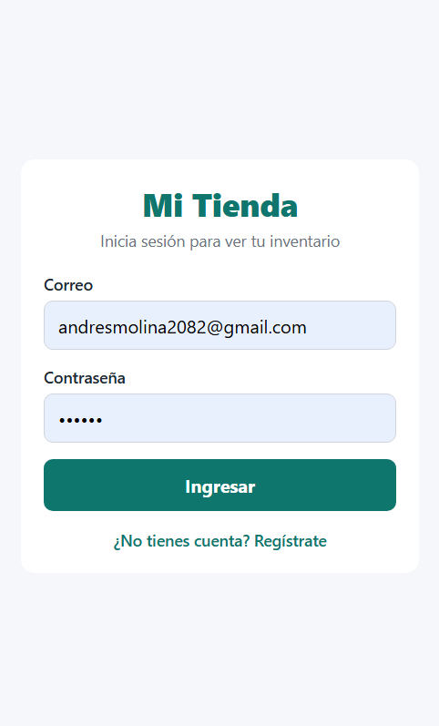
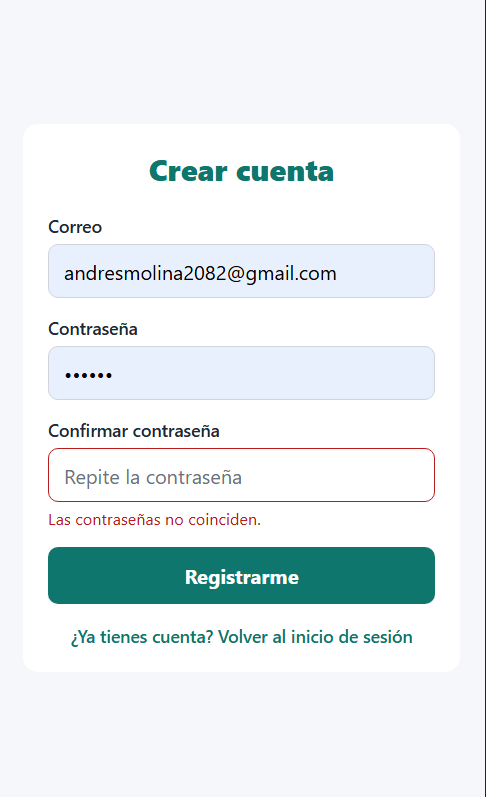
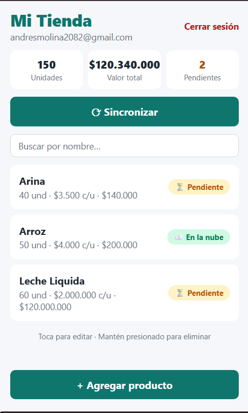
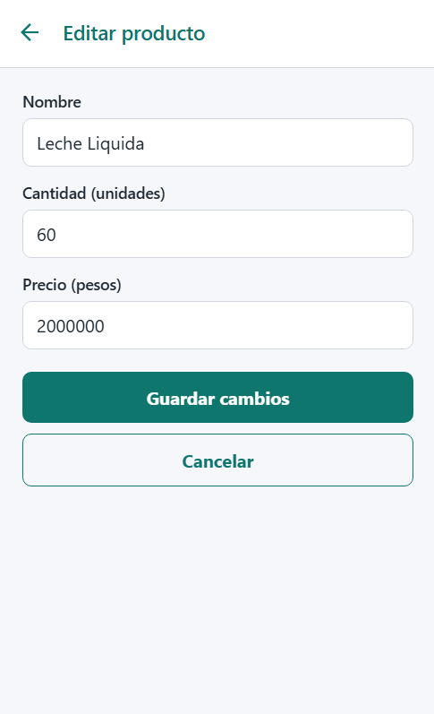
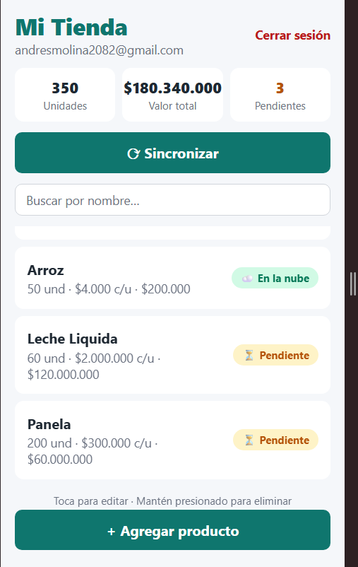
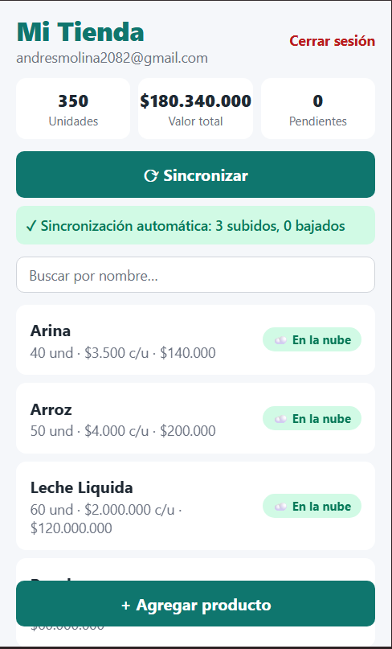
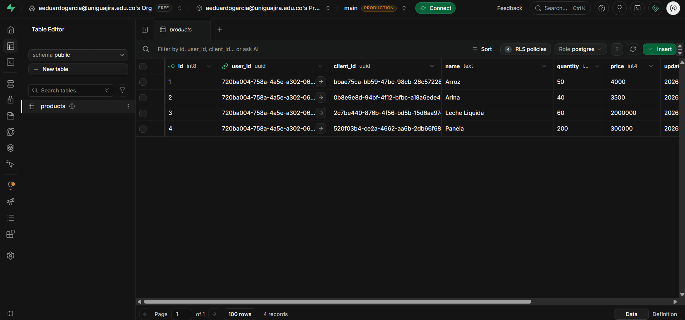

# Mi Tienda — Parcial

App de inventario para una tienda de barrio. Funciona sin internet (SQLite es la fuente de verdad) y respalda los productos en Supabase al tocar **Sincronizar**.

- **Estudiante:** Andrés Molina
- **Código:** _PENDIENTE: escribir el código estudiantil_

**Tecnología:** Expo SDK 57 · TypeScript · Expo Router · SQLite con Drizzle ORM · Supabase (Auth + Postgres con RLS)

## Cómo ejecutar el proyecto

1. **Crear el `.env`** a partir de la plantilla y llenar los valores del proyecto de Supabase (Project Settings → API Keys). Solo la URL y la **publishable key**:
   ```bash
   cp .env.example .env
   ```
   ```
   EXPO_PUBLIC_SUPABASE_URL=https://<tu-proyecto>.supabase.co
   EXPO_PUBLIC_SUPABASE_PUBLISHABLE_KEY=sb_publishable_...
   ```
2. **Ejecutar el SQL** de [`supabase.sql`](supabase.sql) en el SQL Editor de Supabase (crea la tabla `products` con RLS y sus cuatro políticas).
3. En **Authentication → Sign In / Providers → Email**, desactivar **Confirm email** (si no, el registro no inicia sesión).
4. Instalar y arrancar:
   ```bash
   npm install
   npx expo start
   ```
   Escanear el QR con Expo Go. La migración de SQLite se aplica sola al abrir la app (`useMigrations`).

Si se cambia `db/schema.ts`, la migración se regenera con `npx drizzle-kit generate`.

## Estructura

```
app/
  _layout.tsx        Migraciones + AuthProvider + Stack.Protected
  login.tsx          Inicio de sesión
  registro.tsx       Registro con validaciones
  index.tsx          Inventario: lista, totales, pendientes, Sincronizar, búsqueda
  producto.tsx       Crear / editar (con ?id=)
context/AuthContext.tsx   signUp, signInWithPassword, signOut
lib/secureStorage.ts      Sesión en SecureStore por fragmentos
lib/supabase.ts           Cliente de Supabase
db/schema.ts              Tabla products (Drizzle)
db/client.ts              Conexión SQLite
db/repositories/products.ts   Única capa que usa Drizzle
hooks/useProducts.ts      useLiveQuery + totales (las pantallas no importan Drizzle)
hooks/useSync.ts          Botón Sincronizar + auto-sync al volver la conexión
services/sync.ts          syncProducts(userId): bajar y luego subir
drizzle/                  Migración generada con drizzle-kit
```

## Cómo funciona la sincronización

`syncProducts(userId)` en [`services/sync.ts`](services/sync.ts):

1. **Bajar:** `select` de `products` en Supabase (RLS solo devuelve los del usuario). Los que no existen en SQLite (por `client_id`) se insertan con `syncedAt = updatedAt`, es decir, ya sincronizados.
2. **Subir:** se buscan los pendientes (`syncedAt` vacío o menor que `updatedAt`), se envían con `upsert(..., { onConflict: 'client_id' })` —así nunca se duplican filas— y se marcan con `syncedAt` = el `updatedAt` que se subió.

La pantalla muestra el resultado ("2 subidos, 1 bajado") o el error si no hay conexión.

## Capturas

### 1. Login


### 2. Registro con validación


### 3. Pantalla principal


### 4. Formulario editando


### 5. Producto creado sin conexión (pendiente)


### 6. Después de sincronizar


### 7. Tabla en Supabase


## Qué quedó funcionando

- [x] Login, registro (correo válido, contraseña ≥ 6, confirmación igual) y cerrar sesión, con mensajes de error visibles.
- [x] Sesión guardada en SecureStore (adaptador por fragmentos); sigue iniciada al cerrar y abrir la app.
- [x] Rutas protegidas con `Stack.Protected`: sin sesión solo Login/Registro, con sesión solo Principal/Formulario.
- [x] Tabla `products` en SQLite con Drizzle, migración con `drizzle-kit generate` aplicada con `useMigrations`.
- [x] CRUD completo en local (funciona en modo avión), lista reactiva con `useLiveQuery`, total de unidades y valor del inventario.
- [x] Confirmación antes de eliminar (mantener presionado el producto).
- [x] Indicador por producto (⏳ Pendiente / ☁️ En la nube) y contador de pendientes.
- [x] Sincronizar: baja lo que falta y sube pendientes con upsert por `client_id` (sin duplicados).

### Puntos extra

- [x] **Borrado sincronizado** con borrado lógico (`deletedAt`): al sincronizar se borra en Supabase y después en el teléfono. Si el producto nunca se subió, se borra de una vez.
- [x] **Gana el último cambio:** al bajar, si la versión de la nube tiene `updated_at` más reciente que la local, la reemplaza.
- [x] **Sincronización automática** al recuperar la conexión (NetInfo).
- [x] **Búsqueda por nombre** en la pantalla principal.

### Decisiones adicionales

- La tabla local tiene una columna extra `userId` para que, si otra cuenta inicia sesión en el mismo teléfono, no vea ni suba los productos de la anterior.

## Qué faltó

_PENDIENTE: completar después de probar en el teléfono (o escribir "Nada")._
